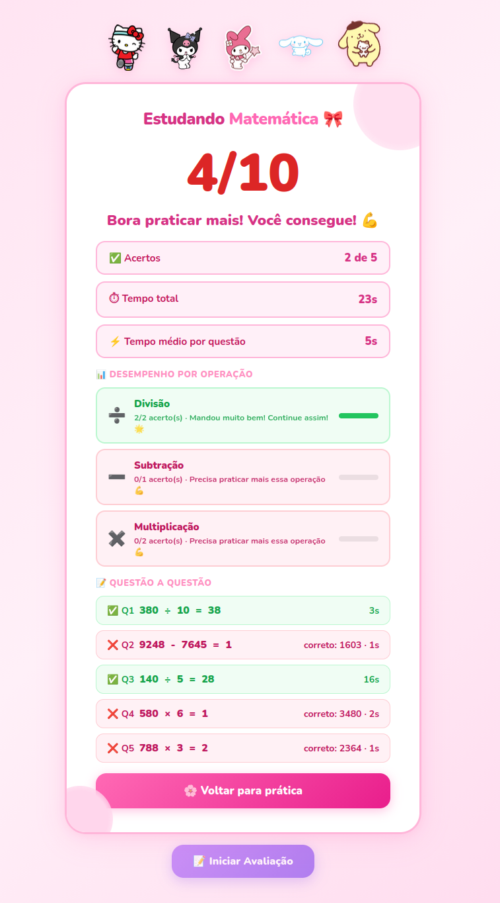

# 🎀 Estudando Matemática

App web para praticar matemática básica do 6º ano, com visual temático Hello Kitty.


---

## 📸 Telas

<table>
  <tr>
    <td align="center"><b>Modo Prática</b></td>
    <td align="center"><b>Modo Avaliação</b></td>
  </tr>
  <tr>
    <td></td>
    <td></td>
  </tr>
</table>

---

## ✨ Funcionalidades

### Modo Prática
- Questões infinitas com feedback imediato após cada resposta
- GIFs animados de reação (acerto e erro)
- Placar em tempo real com acertos, tentativas e aproveitamento

### Modo Avaliação
- Contagem regressiva de 3s antes de começar
- 8 questões seguidas sem distrações, estilo prova
- Avaliação sempre mistura operações diretas, 1 problema curto, 2 problemas de interpretação e 1 decomposição
- Tela de loading com barra de aproveitamento animada ao final
- Resultado completo com:
  - Nota (0–10)
  - Tempo total e tempo médio por questão
  - Desempenho separado por operação com feedback personalizado
  - Detalhamento questão a questão

### Operações
| Operação | Regra |
|---|---|
| Soma | Parcelas de 3–4 dígitos |
| Subtração | Resultado sempre positivo, números grandes |
| Multiplicação | Esquerda até 3 dígitos × direita 1 dígito |
| Divisão | Divisor até 10, dividendo grande, sempre exata |
| Decomposição | Número de até 5 dígitos em forma expandida, com os sinais de + já na tela |
| Problemas interpretativos | Enunciados curtos envolvendo soma, subtração, multiplicação e divisão |
| Problemas de interpretação | Problemas de várias etapas (compras, troco, dividir o que sobrou, dobro/triplo...) com personagens e números sorteados; ~25 modelos em `js/exercises.js` |

---

## 🚀 Como usar

O app é 100% estático (HTML + JavaScript), não precisa de servidor nem de instalar nada.
O placar e os tipos de exercício escolhidos ficam salvos no próprio navegador.

**Online:** https://alissonrp.github.io/sister_studies/

**Localmente:**

```bash
python -m http.server 8000
```

Acesse **http://localhost:8000** no navegador.

No celular, abra o link e use **"Adicionar à tela inicial"** para ele virar um ícone de app.

---

## 🌐 Deploy (GitHub Pages)

Todo `git push` na branch `main` publica o site automaticamente pelo workflow
`.github/workflows/pages.yml`. Na primeira vez, confira em **Settings → Pages** se a
opção **Source** está como **GitHub Actions**.

A prévia do link no WhatsApp usa a imagem `static/og-image.png` e as tags `og:*` do
`index.html`. Se mudar o endereço do site, atualize as URLs dessas tags.

---

## 📁 Estrutura

```
├── index.html               # telas, estilos e interação
├── js/
│   └── exercises.js         # geração e correção das questões
├── manifest.webmanifest     # "Adicionar à tela inicial"
├── favicon.ico
├── static/
│   ├── og-image.png         # prévia do link (WhatsApp etc.)
│   ├── icons/               # favicon e ícones do app
│   ├── gifs/
│   └── images/
└── .github/workflows/pages.yml
```
